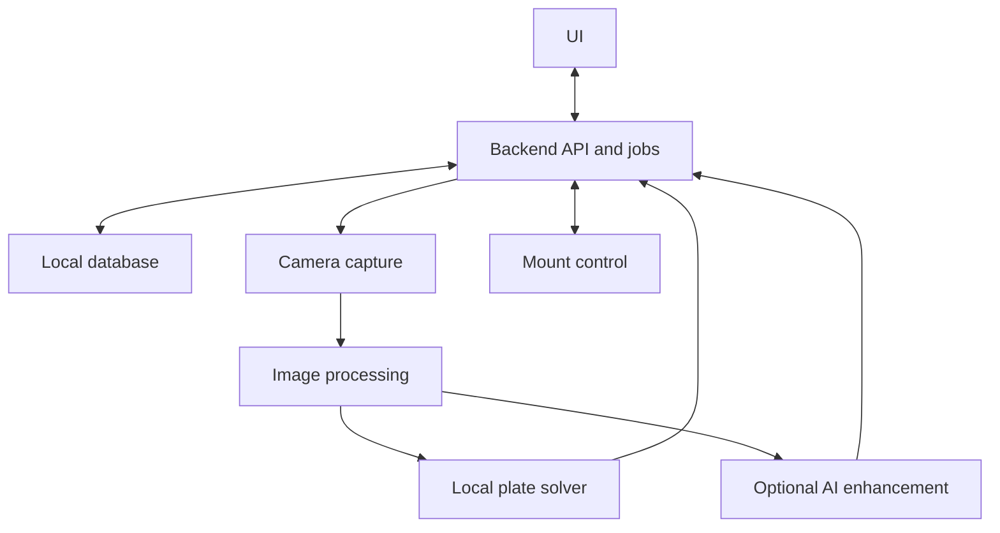

# Architecture baseline

Status: proposed component boundaries; implementation pending.

## Local execution

The UI communicates with a local backend. The backend owns jobs, device state, and persistence. Camera capture, image processing, plate solving, and optional AI enhancement execute on the local computer. These folders are code boundaries, not a requirement to deploy a separate service per folder.

## Communication proposal

Use HTTP for commands and queries, and WebSocket events for job and device status. Preview transport should be chosen after inspecting the existing UI. Send frame references and metadata between local workers rather than copying full raw image arrays into JSON. Keep CPU-heavy solver and processing work outside the API request loop.

Begin with one backend and bounded local worker queues. Add separate services or a broker only when measured requirements justify them. Store metadata and job records in a local database; store captures and generated images in local files.

## Capture and solve

1. UI requests a capture or solve job.
2. Backend validates device state and creates a job ID.
3. Camera writes an immutable capture and metadata.
4. Image processing creates solver input without changing the original.
5. Solver runs locally with installed indexes and a bounded timeout.
6. Backend stores the result and publishes status to the UI.
7. A separate explicit control action may use validated results to correct pointing.

Latest previews may be dropped under load. Accepted capture jobs must complete, fail clearly, or be cancelled explicitly. Use bounded queues and report overload instead of accumulating unlimited work.

## Mount control

Only the mount controller sends hardware commands. Reject motion while disconnected, validate coordinates and configured movement limits, and serialize conflicting commands. Provide stop and cancellation paths. Plate-solving results alone do not authorize motion. Preserve coordinate frame, units, observation time, and equinox/epoch where applicable across every boundary.

## Recovery

Every long operation needs a job ID, timeout, cancellation behavior, and an error visible to the UI. Mark interrupted jobs after restart and reconcile actual device state before accepting further commands. Never automatically replay a previous movement command.

## Optional enhancement

AI consumes derived images and produces separately labelled outputs. It must not become a dependency of capture, solving, or mount commands. Do not use enhanced images as scientific originals.
