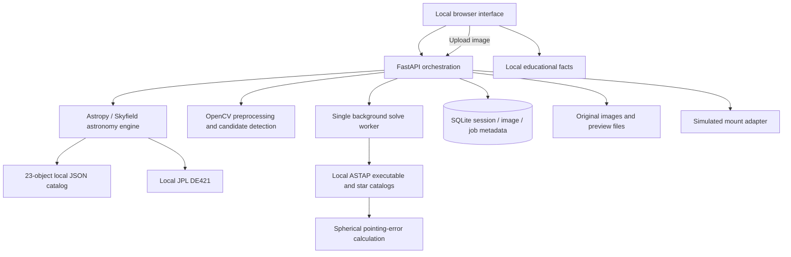

# Image prototype architecture and requirement mapping

The added offline identification stage is documented in
[offline-identification.md](offline-identification.md). It retains full WCS,
projects a versioned local catalog, accepts unique source matches, and persists
labels with solves and observations. The agreed overall roadmap is in
[offline-first-plan.md](offline-first-plan.md).

## Source and scope

The implementation is based on the attached capstone draft,
`AstroLearn22222.docx (original project report, supplied separately)`, Appendix A, Appendix B, Table 26,
and Table 28. The user's latest instructions replace the Pi with a laptop and
replace camera capture with uploaded pictures, with offline plate solving added.
The report proposes hardware selections; it does not establish that those parts
have been purchased or integrated. Original phase 1–2 notes are archived separately.

## Components and data flow

`main.py` assembles the application and retains the foundation APIs.
`prototype.py` coordinates image ingestion, solve jobs, session creation and
simulation endpoints. `astronomy.py` provides target positions; `imaging.py`
decodes pictures and computes candidate sources. `solver.py` runs real ASTAP
without a shell. `prototype_store.py` persists JSON metadata in SQLite while
images remain files, matching the report's ownership model. `mount.py` exposes
a bench simulation; its timed steps are not an encoder measurement.

The browser UI is a deliberate laptop substitution for the proposed Flutter
touchscreen. It has no build step or cloud host. A later Flutter application can
call the same API. There is no camera, microphone, geolocation permission, UART
connection, autonomous motor command, hidden cloud fallback, or assumed pin map.

## Prototype coverage

| Report requirement | Laptop implementation | Remaining evidence |
|---|---|---|
| Appendix A GPS / UTC to position | Manual latitude, longitude, elevation, timezone-aware time; offline astronomy | GPS receiver and independent 0.1° planetarium comparison |
| Appendix A commanded motor steps | RA/DEC step simulation, moving/busy states | Actual UART framing, direction and steps on hardware |
| Appendix A stop within 1 second | Latched simulated stop with explicit reset | Independent power cutoff and measured mechanical stop time |
| Appendix A source markers | Real OpenCV detections displayed over uploaded images | Real camera exposure/focus tests |
| FR-SW-01 positions | Astropy transforms, Skyfield with local DE421 | Reference comparisons and final camera/site calibration |
| FR-SW-02 preprocessing | Background removal, robust threshold, compact components | Detection assessment on labeled real sky data |
| FR-SW-03 plate solving | Real offline ASTAP, background jobs, timeout and failure paths | Wider real-image set and measured success ratio |
| FR-SW-04 corrections | Field-center error calculation; step simulation is separate | Calibrated mechanical mapping, PID, backlash and closed-loop control |
| FR-SW-05 local display | Image viewer, catalog, coordinates, night mode and learning text | Camera feed and final Flutter deployment |
| FR-SW-06 history / offline | SQLite metadata, original files, JSON export, local resources | Full hardware operation with network disabled |

## Coordinate and truth boundaries

RA/DEC API values are degrees; ASTAP's RA hint is converted to hours internally.
Altitudes are geometric, with atmospheric refraction disabled. Site input is
manual, never labeled GPS. Recorded-image observation time is distinct from the
upload timestamp. A recorded target can be below the horizon at the selected time;
that does not invalidate analysis of an older image.

Star catalog coordinates are approximate J2000 positions without proper motion.
Educational magnitudes and distances are approximate; variable stars are labeled.
Planet and Moon positions use the locally installed ephemeris. Without DE421,
Astropy's built-in ephemeris is a labeled fallback; its GCRS direction is not
compared directly to ICRS/J2000 plate solutions. No spurious zero offset is returned.

An unsolved image has no pointing offset. A solved field can be compared with a
target using great-circle separation, avoiding the RA wrap-around error of simple
coordinate subtraction. The report's 0.25° threshold is shown as a **field-center**
comparison, not a claim that the object has been recognized, centered, or tracked.
All physical tracking duration values remain zero. Mount simulation is not coupled
to invented WCS changes or automatically corrected sky photographs.

## Task execution and storage

At most one solver task runs at once; concurrent submissions return 409. New jobs
return 202 and can be polled while the UI and other routes remain responsive.
Subprocess arguments are an array of validated numeric values, never shell text.
Each job gets its own temporary directory so stale result files cannot be reused.
ASTAP has a 120-second timeout. A timeout, missing catalog, malformed output or
insufficient stars produces a failed job. On restart, interrupted jobs become
failed records instead of remaining perpetually queued.

Images have server-generated identifiers and controlled filenames. The browser's
filename never determines a disk path. Raster images are oriented and normalized
to PNG; FITS originals are retained unchanged and previews are stretched separately.
OpenCV markers never modify the original solver input. SQLite writes are
transactional and connections are closed per operation. Each test instance owns
its own temporary database. Image and history endpoints are paginated; export
walks the full observation history.

## Remaining integration

The report's RA/DEC mount, ESP32, TMC2209, GPS, camera and independent E-stop need
real adapters and measured validation. The serial baud rate, framing, heartbeat,
step calibration, travel limits and PID gains remain unconfirmed. Cloud fallback
is omitted by the user's offline preference. AI models, voice interaction,
bright-planet centering and autonomous tracking are not claimed as implemented.
Adding these requires further work; this prototype does not imply a completed
physical telescope or measured satisfaction of all capstone requirements.
